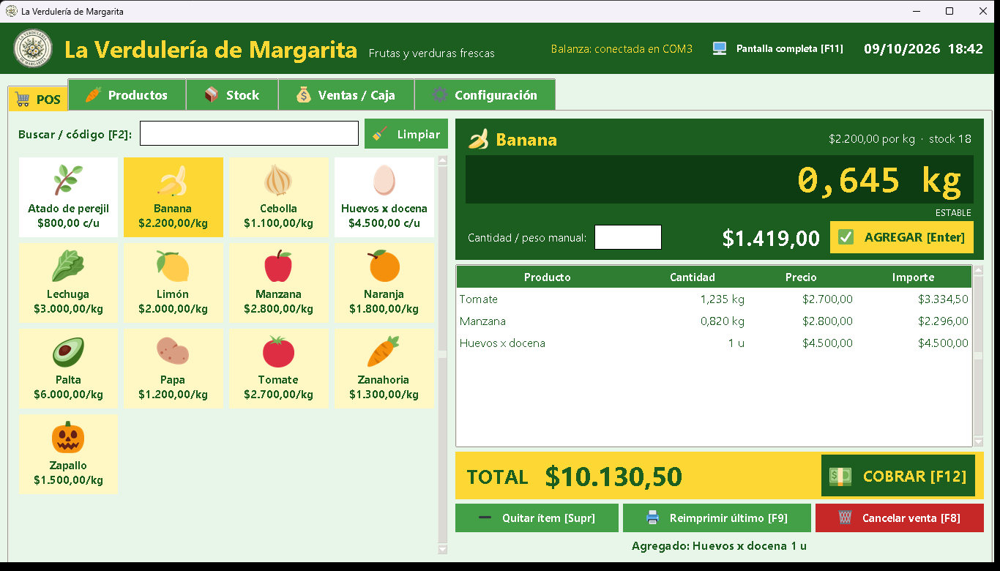
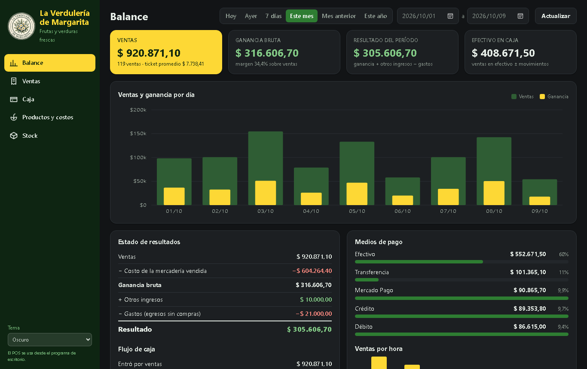
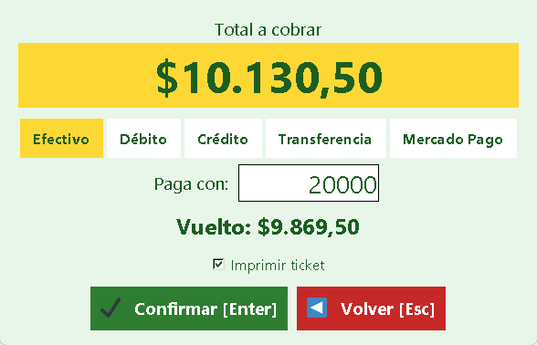
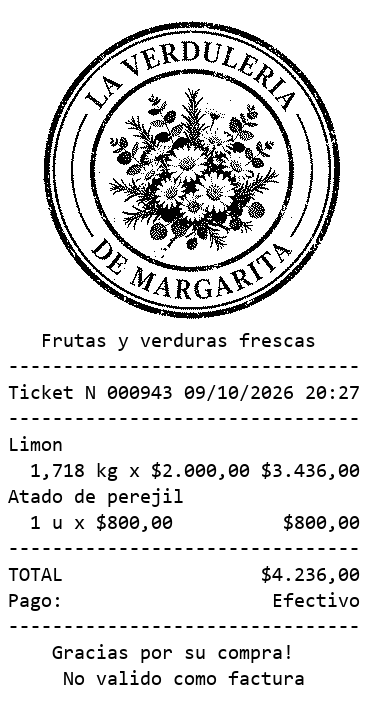
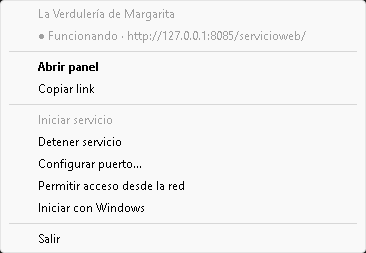

<p align="center">
  
</p>

<h1 align="center">La Verdulería de Margarita</h1>

<p align="center">
  Sistema de gestión para verdulería: <b>POS con balanza</b>, tickets con logo, productos, stock, caja<br>
  y un <b>panel web</b> para ver el negocio desde la PC o el celular. Funciona sin internet.
</p>

<p align="center">
  <a href="https://github.com/fersbrando/margaria_verduleria/raw/main/descargas/VerduleriaMargarita_1.0.0.zip">
    
  </a>
  &nbsp;
  <a href="docs/MANUAL.md">
    
  </a>
</p>

<p align="center"></p>

---

## ⬇ Descargar e instalar

1. Descargá **[VerduleriaMargarita_1.0.0.zip](https://github.com/fersbrando/margaria_verduleria/raw/main/descargas/VerduleriaMargarita_1.0.0.zip)** (20 MB).
2. Abrí el zip y hacé doble clic en **`Instalar_VerduleriaMargarita_1.0.0.exe`**.
   - Si aparece *"Windows protegió su PC"*: **Más información → Ejecutar de todas formas**.
3. **Siguiente → Siguiente → Instalar → Finalizar.**

Listo: en el escritorio quedan **dos accesos directos con el logo**, el **POS** y el **Servicio web**.
El zip también trae el **manual en PDF** con todos los pasos e imágenes.

> Requisitos: Windows 10 u 11 (64 bits). No hace falta instalar Python ni nada más.

## ✨ Qué hace

| | |
|---|---|
| 🛒 **POS** | Tocás el producto, lo apoyás en la balanza, el peso aparece en pantalla y das Enter. Cobro en efectivo (con vuelto), débito, crédito, transferencia o Mercado Pago. |
| ⚖️ **Balanza** | Lee el peso por RS232 / USB (probado para Kretz Aura Eco). Detector automático de protocolo. Sin balanza, el peso se escribe a mano. |
| 🧾 **Tickets** | Con el logo de la verdulería, por la impresora de la balanza (puerto COM), una térmica de Windows o archivo. Reimpresión y anulación. |
| 🥕 **Productos** | Precio, costo y margen; por kilo o por unidad; ícono para cada producto. Aumento de precios por porcentaje desde la web. |
| 📦 **Stock** | Se descuenta con cada venta. Ingreso de mercadería, mermas, aviso de reponer y stock valorizado. |
| 💰 **Caja** | Ventas del día por medio de pago, ingresos, egresos, ganancia y efectivo en caja. |
| 📊 **Panel web** | Balance, estado de resultados, flujo de caja, rentabilidad por producto, ventas (exportar CSV), caja y stock. También desde el celular. |
| 🎨 **A tu gusto** | Temas claro / gris / oscuro, pantalla completa, atajos de teclado configurables. |

<p align="center">
  
</p>

<p align="center">
  &nbsp;
  &nbsp;
  
</p>

## 📖 Manual

El **[manual completo](docs/MANUAL.md)** explica todo con imágenes: instalación, configuración de la balanza y la impresora, cómo vender, productos, stock, caja, atajos, el servicio web, el panel, backup y problemas frecuentes.

## 💾 Tus datos

Todo queda en la PC, en `C:\VerduleriaMargarita\datos` (una venta por archivo, organizadas por `año/mes/día`). Para hacer backup alcanza con copiar esa carpeta. Desinstalar o actualizar **no** borra los datos.

---

## 🛠 Para desarrolladores

Hecho en **Python 3** (tkinter) + **Vue 3** para el panel web.

```bash
pip install -r requirements.txt
python app.py              # POS
python bandeja.py          # servicio web con ícono en la bandeja (o: python servidor.py)
```

Armar el instalador y el zip de descarga (requiere [PyInstaller](https://pyinstaller.org) e [Inno Setup 6](https://jrsoftware.org/isinfo.php)):

```bash
construir_instalador.bat 1.0.1
```

Genera `empaquetar/salida/Instalar_VerduleriaMargarita_1.0.1.exe` y `descargas/VerduleriaMargarita_1.0.1.zip`.

| Archivo | Qué es |
|---|---|
| `app.py` | POS de escritorio (ventas, productos, stock, caja, configuración) |
| `balanza.py` | Lectura del peso por puerto serie |
| `impresora.py` | Ticket: texto, logo ESC/POS, impresión serie / Windows |
| `datos.py` | Guardado en JSON (`datos/productos`, `datos/ventas/aaaa/mm/dd`) y balance |
| `servidor.py` | Servidor web + API del panel |
| `bandeja.py` | Ícono junto al reloj (iniciar/detener, puerto, red, inicio con Windows) |
| `servicioweb/` | Panel web (Vue 3, HTML, CSS, JS; `api.php` para usarlo desde XAMPP/Apache) |
| `iconos.py`, `img/` | Íconos Twemoji y logo (`python img/generar_logo.py` regenera las versiones del logo) |
| `empaquetar/` | PyInstaller, Inno Setup y armado del zip |
| `docs/` | Manual (`MANUAL.md`) y su PDF (`python docs/generar_pdf.py`) |

---

<p align="center">
  © 2026 <b>Fernando S. Brandolini</b> — <b>eRios</b><br>
  Íconos: <a href="https://github.com/twitter/twemoji">Twemoji</a> (CC-BY 4.0) · Panel web: <a href="https://vuejs.org">Vue</a> (MIT)
</p>
