# Manual de uso — La Verdulería de Margarita

<p align="center"></p>

Sistema de gestión para verdulería: **POS con balanza**, tickets con logo, productos, stock, ventas, caja y un **panel web** para ver el negocio desde la PC o el celular.

Versión 1.0.0 · Desarrollado por **Fernando S. Brandolini** · **eRios**

---

## Índice

1. [Qué incluye](#1-qué-incluye)
2. [Requisitos](#2-requisitos)
3. [Descargar e instalar](#3-descargar-e-instalar)
4. [Primer uso: configurar el negocio](#4-primer-uso-configurar-el-negocio)
5. [Vender con el POS](#5-vender-con-el-pos)
6. [Productos](#6-productos)
7. [Stock](#7-stock)
8. [Ventas y caja](#8-ventas-y-caja)
9. [Pantalla, temas y atajos de teclado](#9-pantalla-temas-y-atajos-de-teclado)
10. [Servicio web (ícono junto al reloj)](#10-servicio-web-ícono-junto-al-reloj)
11. [Panel web](#11-panel-web)
12. [Datos, backup, actualizar y desinstalar](#12-datos-backup-actualizar-y-desinstalar)
13. [Problemas frecuentes](#13-problemas-frecuentes)

---

## 1. Qué incluye

| Programa | Para qué sirve |
|---|---|
| **La Verdulería de Margarita** (POS) | Vender: elegir productos, pesar en la balanza, cobrar, imprimir el ticket. También productos, stock, caja y configuración. |
| **La Verdulería de Margarita - Servicio web** | Un ícono junto al reloj de Windows que prende el **panel web**: balance, ventas, caja, costos y stock desde el navegador (o el celular). |

Todo funciona **sin internet**. Los datos quedan en la PC, en la carpeta `C:\VerduleriaMargarita\datos`.

## 2. Requisitos

- Windows 10 u 11 (64 bits).
- Pantalla de 1366 × 768 o más grande.
- Opcional: balanza con salida RS232 (por ejemplo Kretz Aura Eco) y un adaptador USB‑RS232.
- Opcional: impresora de tickets (la integrada a la balanza o una térmica de 58/80 mm).

## 3. Descargar e instalar

### 3.1 Descargar

1. Entrá a **https://github.com/fersbrando/margaria_verduleria**.
2. Tocá **⬇ Descargar instalador** (o el archivo `VerduleriaMargarita_1.0.0.zip`).
3. Abrí el zip. Adentro hay tres cosas:
    - `Instalar_VerduleriaMargarita_1.0.0.exe` → el instalador.
    - `Manual - La Verdulería de Margarita.pdf` → este manual.
    - `LEEME PRIMERO.txt` → los pasos cortos.

### 3.2 Instalar

Hacé doble clic en **`Instalar_VerduleriaMargarita_1.0.0.exe`**.

> **Si aparece "Windows protegió su PC"** (SmartScreen): tocá **Más información → Ejecutar de todas formas**. Aparece porque el programa es nuevo y no tiene firma digital comprada; es normal.
>
> **Si Windows pregunta "¿Permitir que esta aplicación haga cambios?"**: tocá **Sí** (se instala en `C:\`).

**Paso 1 — Carpeta.** Se instala en `C:\VerduleriaMargarita` (recomendado). Tocá **Siguiente**.

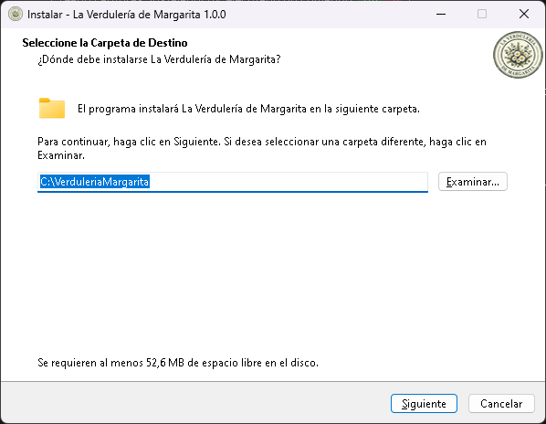

**Paso 2 — Opciones.** Dejá tildado:

- **Crear accesos directos en el escritorio** (el POS y el Servicio web).
- **Iniciar el servicio web automáticamente con Windows** (así el panel está siempre disponible).

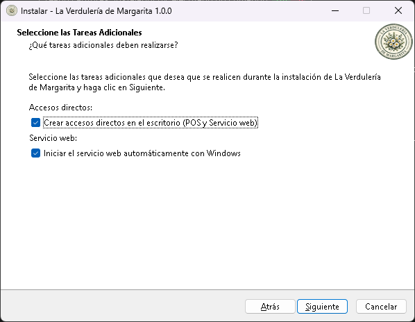

**Paso 3 — Instalar.** Revisá el resumen y tocá **Instalar**.

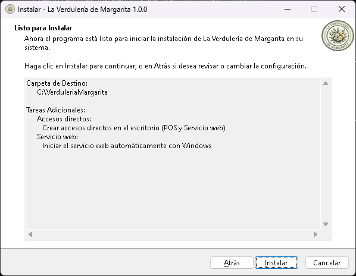

**Paso 4 — Listo.** Dejá tildado "Iniciar el servicio web" y "Abrir el POS" y tocá **Finalizar**.

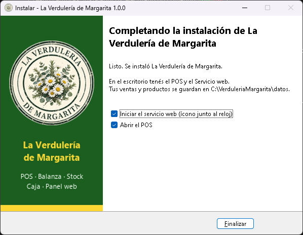

### 3.3 Accesos directos

En el escritorio quedan dos íconos con el logo:

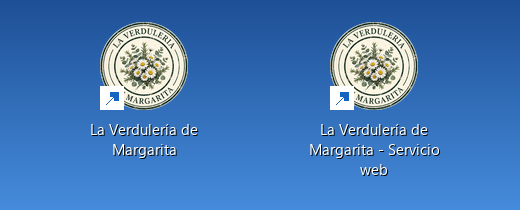

- **La Verdulería de Margarita** → abre el **POS**.
- **La Verdulería de Margarita - Servicio web** → prende el **panel web** (ícono junto al reloj).

También están en el **menú Inicio**, junto con *Carpeta de datos (backup)* y *Desinstalar*.

## 4. Primer uso: configurar el negocio

Abrí el POS y andá a la pestaña **Configuración**. Los cambios se aplican con **Guardar configuración** (abajo a la izquierda).

### 4.1 General: datos del negocio, pantalla y atajos

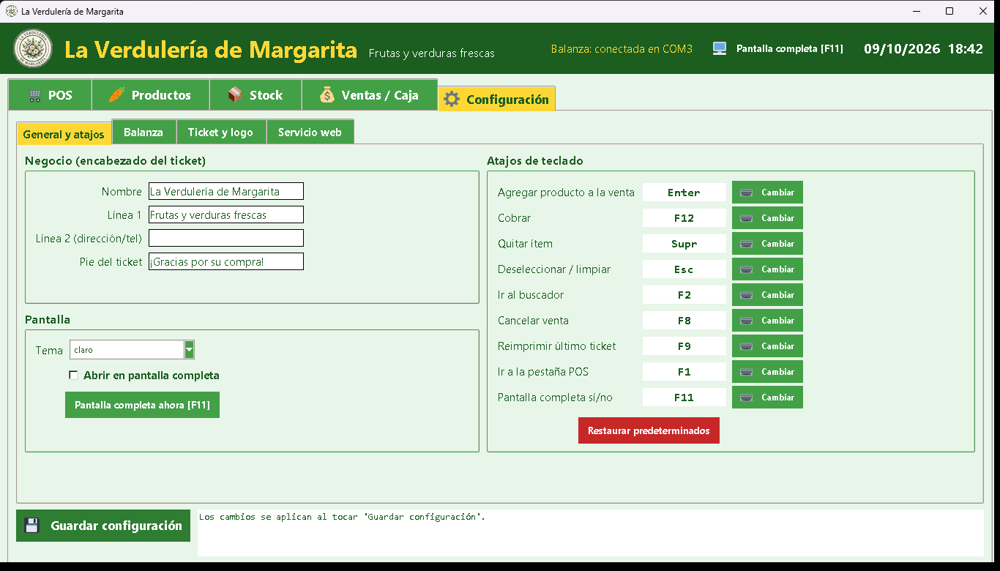

- **Negocio**: nombre, una línea de descripción, dirección/teléfono y el mensaje del pie del ticket.
- **Pantalla**: tema **claro / gris / oscuro** y "Abrir en pantalla completa".
- **Atajos de teclado**: ver [sección 9](#9-pantalla-temas-y-atajos-de-teclado).

### 4.2 Balanza

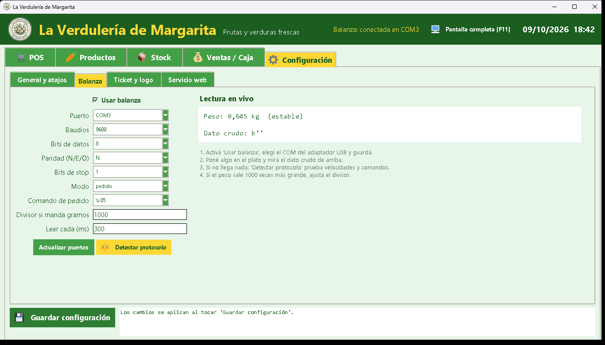

1. Conectá la balanza a la PC con el adaptador USB‑RS232.
2. Fijate qué puerto le dio Windows: *Administrador de dispositivos → Puertos (COM y LPT)* (por ejemplo `COM3`).
3. Tildá **Usar balanza**, elegí ese **Puerto** y tocá **Guardar configuración**.
4. Poné algo en el plato: en **Lectura en vivo** tiene que aparecer el peso.
5. Si no aparece nada, tocá **Detectar protocolo**: el programa prueba velocidades y comandos comunes y muestra cuál respondió. Copiá esos **Baudios** y **Comando** y guardá.
    - Si la balanza manda el peso todo el tiempo sola, usá **Modo: continuo**.
    - Si el peso sale 1000 veces más grande (la balanza manda gramos), dejá **Divisor = 1000**.
    - Algunas balanzas necesitan activar la "comunicación con PC" en su menú o un cable cruzado (null‑modem).

Sin balanza también se puede trabajar: el peso se escribe a mano en el POS.

### 4.3 Ticket y logo

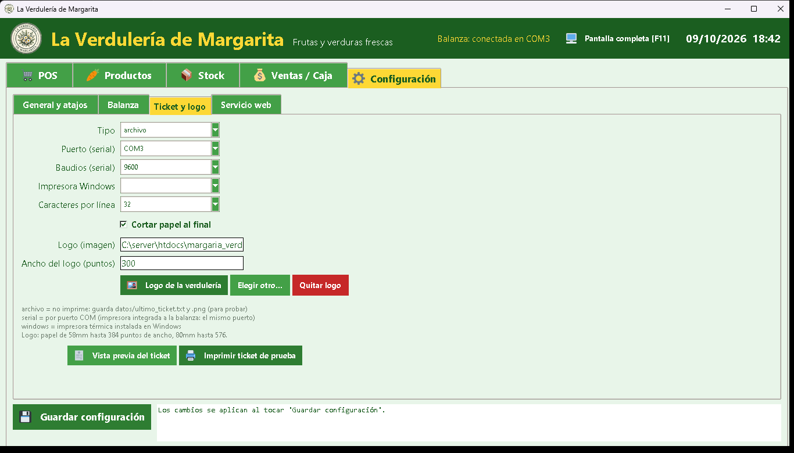

- **Tipo de impresora**:
    - `serial` → impresora **integrada a la balanza** o térmica por puerto COM. Si está en la balanza, usá **el mismo puerto COM de la balanza**.
    - `windows` → impresora térmica instalada en Windows (elegila en la lista).
    - `archivo` → no imprime; guarda el ticket como texto e imagen (sirve para probar).
    - `ninguna` → no imprime.
- **Caracteres por línea**: 32 para papel de 58 mm, 48 para 80 mm.
- **Logo**: ya viene el sello de la verdulería. Con **Elegir otro…** podés usar otra imagen.
- Tocá **Vista previa del ticket** para verlo y **Imprimir ticket de prueba** para probar la impresora.

Así sale el ticket:

<p align="center"></p>

## 5. Vender con el POS


### 5.1 Una venta, paso a paso

1. **Elegí el producto**: tocá su botón (o escribí el código o el nombre en *Buscar* y apretá **Enter**).
2. **Si es por kilo**: apoyalo en la balanza. El peso aparece en grande y el importe se calcula solo. Cuando dice **ESTABLE**, apretá **Enter** (o **AGREGAR**).
    - Sin balanza: escribí el peso en *Cantidad / peso manual* (por ejemplo `0,850`) y **Enter**.
3. **Si es por unidad** (huevos, atados): escribí la cantidad y **Enter**.
4. Repetí con cada producto. A la derecha se va armando la lista y el **TOTAL**.
5. Apretá **F12** (o **COBRAR**).

### 5.2 Cobrar


1. Elegí el medio de pago: **Efectivo, Débito, Crédito, Transferencia o Mercado Pago**.
2. En efectivo, escribí **con cuánto paga**: el **vuelto** se calcula solo.
3. **Enter** para confirmar. Se guarda la venta, se descuenta el stock y sale el ticket.

### 5.3 Corregir

| Quiero… | Cómo |
|---|---|
| Sacar un producto de la lista | Seleccionalo y **Supr** (o *Quitar ítem*). Sin seleccionar, saca el último. |
| Vaciar la venta que estoy armando | **F8** (o *Cancelar venta*). |
| Volver a imprimir el último ticket | **F9** (o *Reimprimir último*). |
| Anular una venta ya cobrada | Pestaña **Ventas / Caja** → [sección 8](#8-ventas-y-caja). |

## 6. Productos

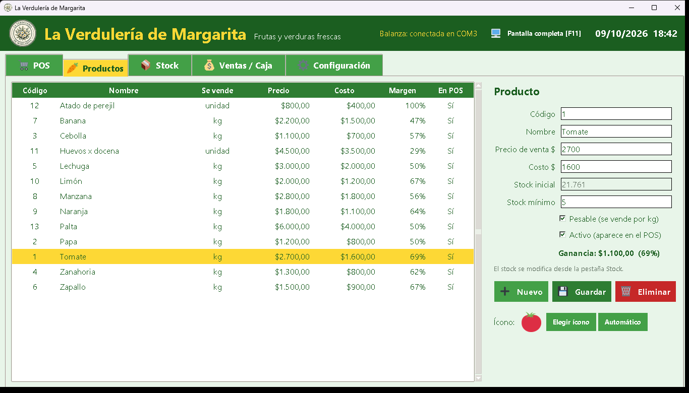

- **Nuevo** → completá código (o dejalo automático), nombre, **precio de venta**, **costo**, stock inicial y stock mínimo. Tildá **Pesable** si se vende por kilo. **Guardar**.
- Para **modificar**, tocá el producto en la lista, cambiá lo que necesites y **Guardar**. El margen de ganancia se ve al momento.
- **Activo**: destildalo para ocultar un producto del POS sin borrarlo.
- **Ícono**: se elige solo según el nombre ("Tomate perita" → 🍅). Con **Elegir ícono** podés cambiarlo:

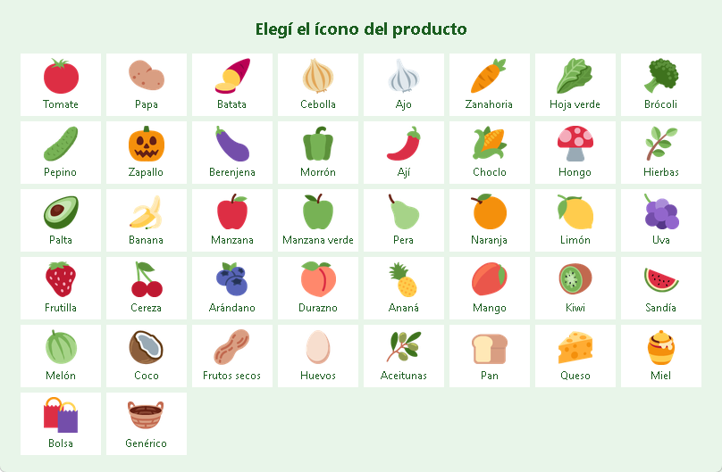

> Los precios también se pueden cambiar desde el panel web, incluso **todos juntos por porcentaje** ([sección 11.5](#115-productos-y-costos)).

## 7. Stock

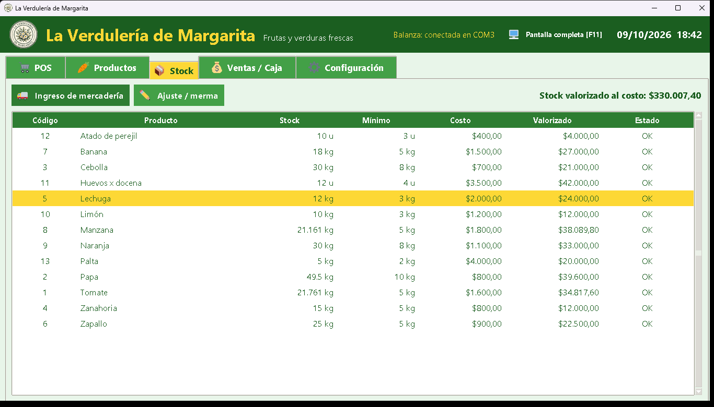

- En rojo y con **REPONER** aparecen los productos que llegaron al stock mínimo.
- **Ingreso de mercadería** (o doble clic en el producto): cantidad que entró y costo. Si tildás *Registrar el pago como egreso de caja*, la compra queda anotada en la caja.

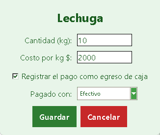

- **Ajuste / merma**: escribí el stock real contado y el motivo (merma, rotura, conteo).
- Cada venta descuenta stock y cada anulación lo devuelve. Todo queda registrado.

## 8. Ventas y caja

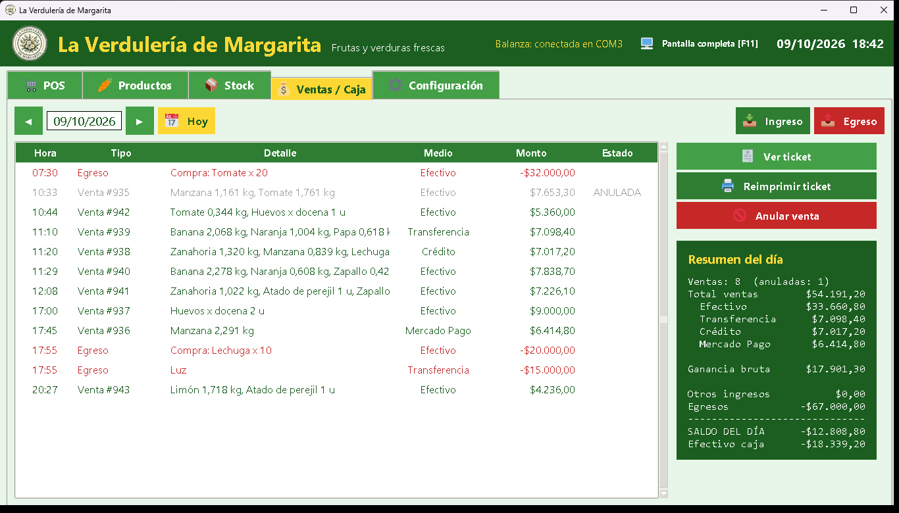

- Con **◀ ▶** o escribiendo la fecha elegís el día. **Hoy** vuelve al día actual.
- La lista muestra ventas, ingresos y egresos del día. A la derecha está el **Resumen del día**: total por medio de pago, ganancia, egresos, saldo y **efectivo en caja**.
- **Ver ticket** (o doble clic) muestra el ticket tal cual se imprimió. **Reimprimir ticket** lo vuelve a imprimir.

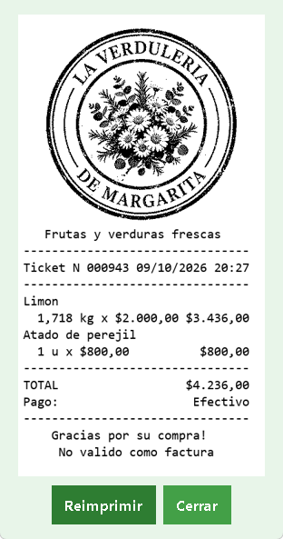

- **Anular venta**: pide el motivo, devuelve el stock y deja la venta marcada como **ANULADA** (no se borra, queda el registro).
- **Ingreso / Egreso**: para anotar plata que entra o sale de la caja que no es una venta (bolsas, luz, flete, aporte de cambio…).

## 9. Pantalla, temas y atajos de teclado

### Pantalla completa
**F11** entra y sale de pantalla completa (también el botón de arriba a la derecha). En *Configuración → General* podés hacer que abra siempre así.

### Temas
Claro (el de las capturas), **gris** u **oscuro**:

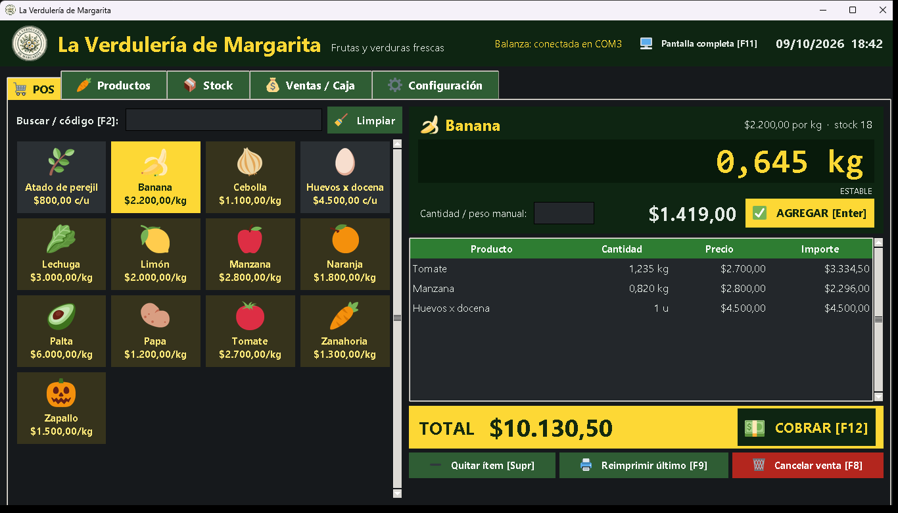

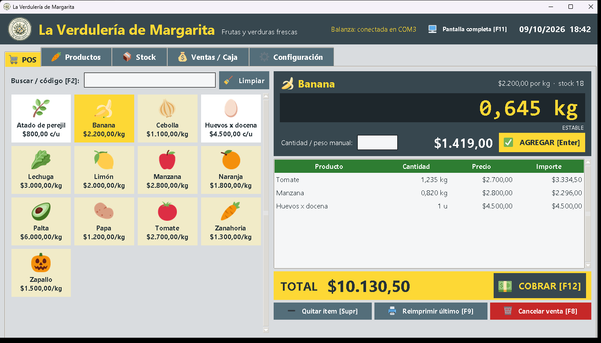

### Atajos

| Acción | Tecla de fábrica |
|---|---|
| Agregar producto | **Enter** |
| Cobrar | **F12** |
| Quitar ítem | **Supr** |
| Deseleccionar / limpiar | **Esc** |
| Ir al buscador | **F2** |
| Cancelar venta | **F8** |
| Reimprimir último ticket | **F9** |
| Ir a la pestaña POS | **F1** |
| Pantalla completa | **F11** |

Para cambiar uno: *Configuración → General → Atajos de teclado → Cambiar*, apretá la tecla nueva (puede ser una combinación como Ctrl+P) y **Usar esta tecla**. Los botones muestran siempre la tecla asignada.

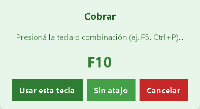

## 10. Servicio web (ícono junto al reloj)

El servicio web se prende con el acceso directo **La Verdulería de Margarita - Servicio web** (o solo al prender la PC, si lo elegiste al instalar). Aparece el **sello junto al reloj** de Windows: **a color** = funcionando, **gris** = detenido.

> ¿No lo ves? Tocá la flechita **^** de la barra de tareas. Podés arrastrarlo afuera para que quede siempre a la vista.

**Doble clic** abre el panel. **Clic derecho**:


| Opción | Qué hace |
|---|---|
| **Abrir panel** | Abre el panel en el navegador. |
| **Copiar link** | Copia la dirección del panel. Con acceso desde la red, copia la dirección para el celular. |
| **Iniciar / Detener servicio** | Prende o apaga el panel web (el POS sigue funcionando igual). |
| **Configurar puerto…** | Cambia el puerto (por defecto **8085**). |
| **Permitir acceso desde la red** | Deja entrar desde otras PCs o el celular conectados al mismo WiFi. |
| **Iniciar con Windows** | El ícono aparece solo al prender la PC. |
| **Salir** | Apaga el servicio y saca el ícono. |

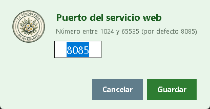

### Ver el panel desde el celular

1. Clic derecho en el ícono → **Permitir acceso desde la red**.
2. En el POS: *Configuración → Servicio web* → poné una **Clave** → *Guardar configuración*. Después, en el ícono: *Detener* e *Iniciar servicio*.
3. Clic derecho → **Copiar link** y abrí ese link en el celular (conectado al mismo WiFi). Pide usuario (cualquiera) y la clave.

## 11. Panel web

Se abre en el navegador (`http://127.0.0.1:8085/servicioweb/`). Arriba elegís el período: **Hoy, Ayer, 7 días, Este mes, Mes anterior, Este año** o fechas a mano. Abajo a la izquierda está el **tema** (claro, gris, oscuro). Se actualiza solo cada minuto.

### 11.1 Balance

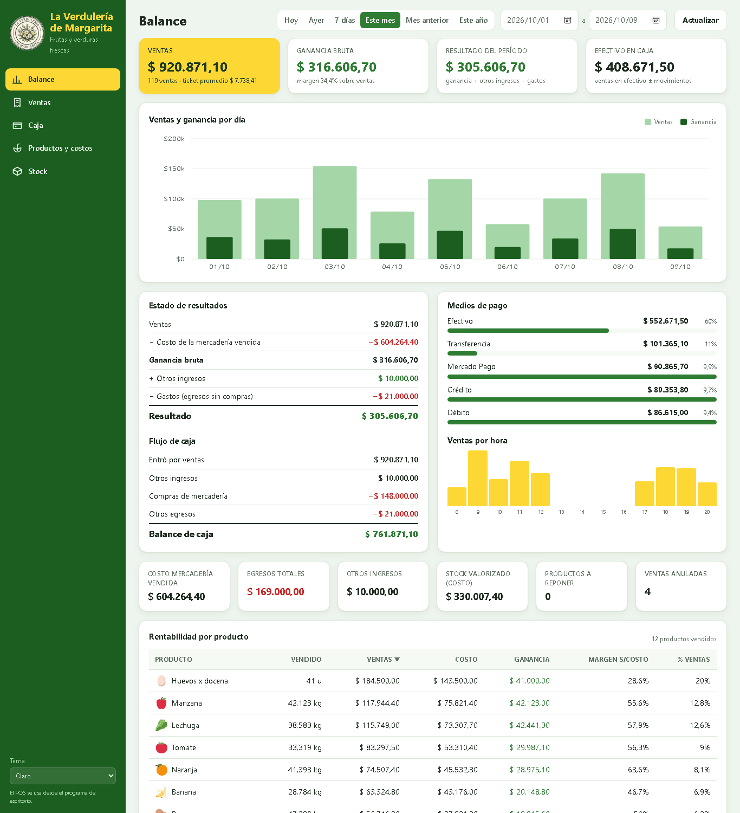

- **Ventas**, **ganancia bruta** (ventas − costo de lo vendido), **resultado del período** y **efectivo en caja**.
- Gráfico de ventas y ganancia por día (por mes en períodos largos).
- **Estado de resultados** y **flujo de caja**. Las compras de mercadería cargadas como egreso ya están dentro del costo de lo vendido, por eso el *resultado* solo resta los demás gastos (luz, bolsas, flete…); el *balance de caja* sí resta todo lo que salió.
- Medios de pago, ventas por hora y **rentabilidad por producto** (cuánto se vendió, costo, ganancia y margen de cada uno).

En tema oscuro:


### 11.2 Ventas

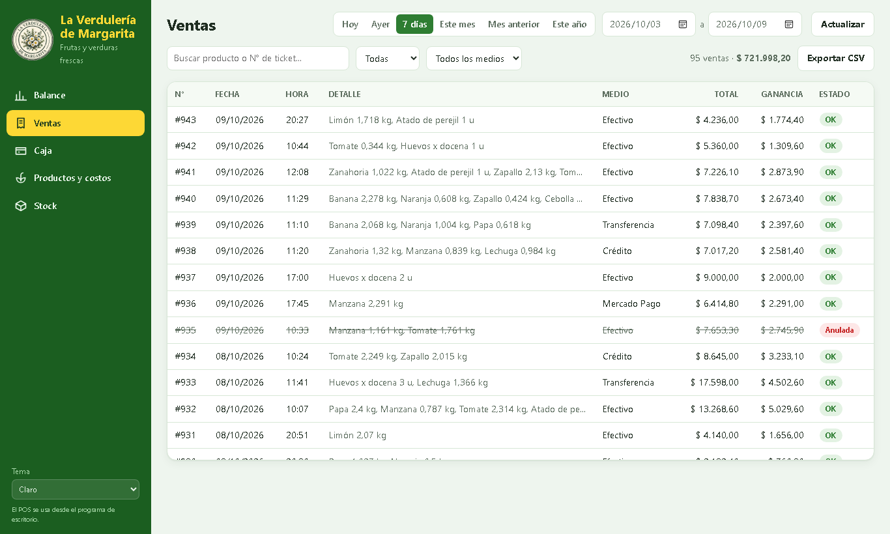

Buscá por producto o número de ticket, filtrá por estado o medio de pago. Tocá una venta para ver el detalle y el ticket, o **anularla**. **Exportar CSV** baja las ventas para abrirlas en Excel.

### 11.3 Caja

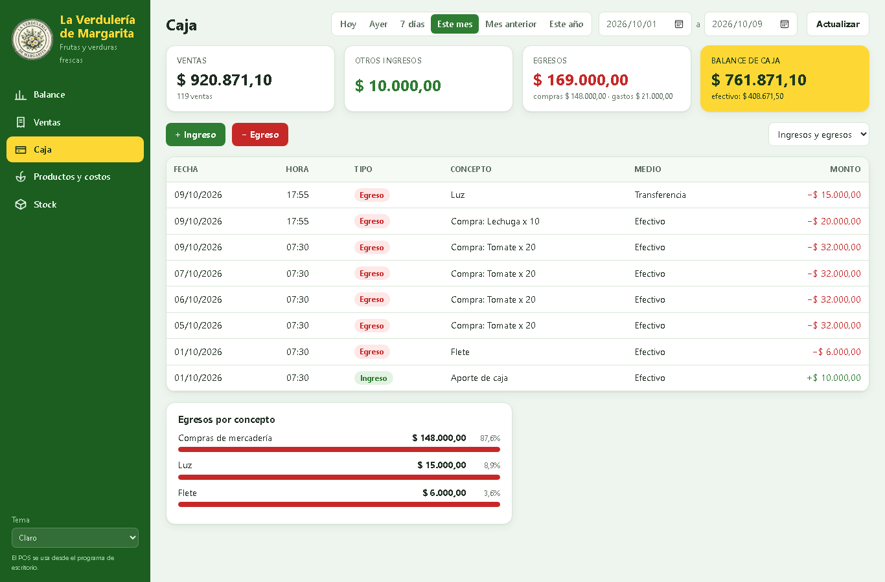

Ingresos y egresos del período, egresos agrupados por concepto y botones **+ Ingreso / − Egreso**.

### 11.4 Stock

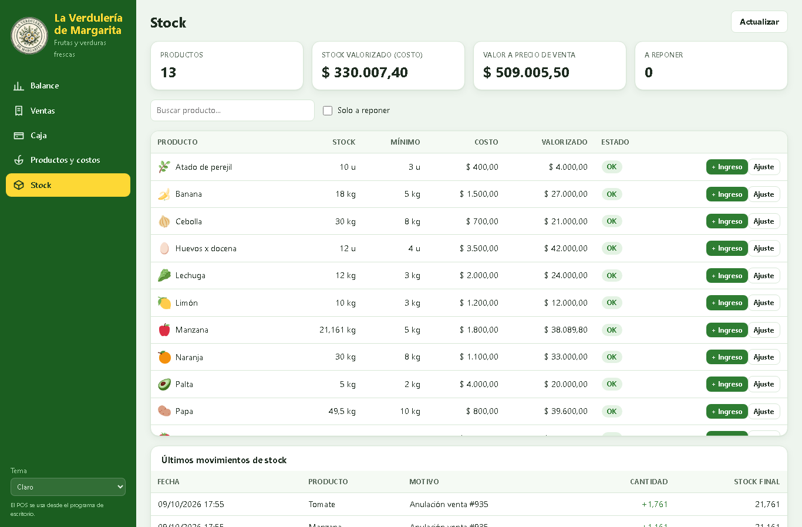

Stock valorizado al costo y a precio de venta, productos a reponer, **ingreso de mercadería**, **ajustes** y el historial de movimientos.

### 11.5 Productos y costos

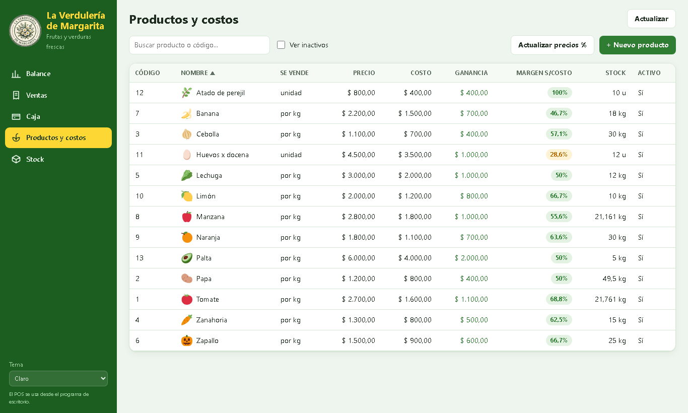

- Precio, costo, ganancia y **margen sobre costo** de cada producto (en rojo los de margen bajo).
- Tocá un producto para editarlo (también el ícono).
- **Actualizar precios %**: sube (o baja) los precios de todos los productos de la lista de una vez, con redondeo a $10, $50 o $100. Usá el buscador para aplicarlo solo a algunos.

### 11.6 En el celular

<p align="center">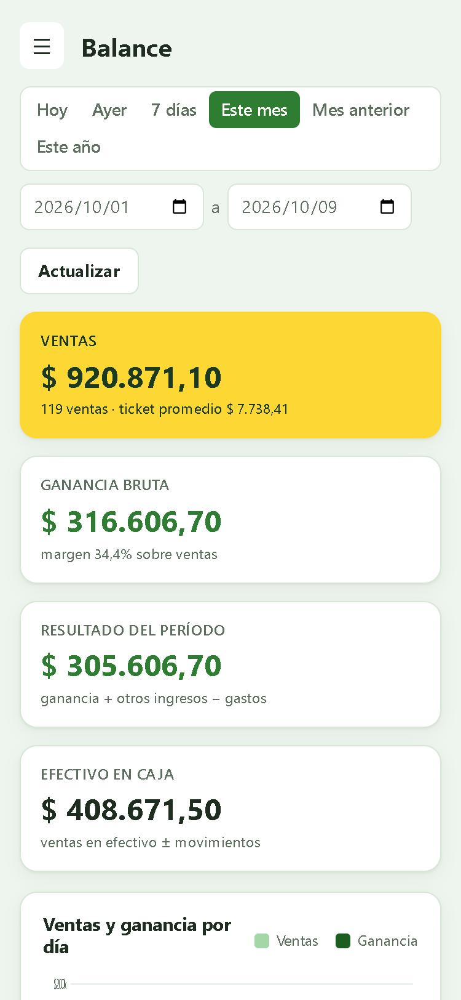</p>

## 12. Datos, backup, actualizar y desinstalar

### Dónde se guarda todo
```
C:\VerduleriaMargarita\
├── config.json                          configuración
└── datos\
    ├── productos\productos.json         productos, precios, costos, stock
    ├── productos\movimientos_stock.jsonl historial de stock
    └── ventas\AAAA\MM\DD\
        ├── venta_000123.json            una venta por archivo
        ├── egreso_*.json                egresos de caja
        └── ingreso_*.json               otros ingresos
```

### Backup
Copiá la carpeta **`C:\VerduleriaMargarita\datos`** y el archivo **`config.json`** a un pendrive o a la nube (menú Inicio → *Carpeta de datos (backup)*). Para recuperar, copialos de vuelta en el mismo lugar con el programa cerrado.

### Actualizar
Instalá la versión nueva **encima** (mismo instalador, versión más nueva). Se conservan los datos y la configuración. Si el POS o el servicio están abiertos, el instalador pide cerrarlos.

### Desinstalar
*Configuración de Windows → Aplicaciones → La Verdulería de Margarita → Desinstalar* (o menú Inicio → *Desinstalar*). **La carpeta `datos` no se borra**, para no perder ventas.

## 13. Problemas frecuentes

| Problema | Solución |
|---|---|
| **La balanza no muestra el peso** | Revisá el puerto COM, que esté tildado *Usar balanza* y usá *Detectar protocolo* ([4.2](#42-balanza)). Probá otro cable (null‑modem) o activar la comunicación con PC en el menú de la balanza. |
| **El peso sale 1000 veces más grande** | *Configuración → Balanza → Divisor* = 1000. |
| **No imprime el ticket** | Revisá *Tipo* y *Puerto* en *Ticket y logo* y tocá *Imprimir ticket de prueba*. Con impresora integrada a la balanza, usá el mismo COM. Si la balanza no imprime lo que le manda la PC, conviene una ticketera USB (tipo `windows`). |
| **Caracteres raros o líneas cortadas en el ticket** | Ajustá *Caracteres por línea* (32 para 58 mm, 48 para 80 mm). |
| **"El POS ya está abierto"** | Ya hay un POS abierto: buscalo en la barra de tareas. |
| **No veo el ícono del servicio** | Flechita **^** junto al reloj. Si no está, abrí el acceso directo *Servicio web*. |
| **El servicio no inicia (puerto ocupado)** | Clic derecho → *Configurar puerto…* y elegí otro (por ejemplo 8090). |
| **El panel no abre desde el celular** | Activá *Permitir acceso desde la red*, conectá el celular al mismo WiFi y usá *Copiar link*. Si Windows pregunta por el firewall, permití el acceso en redes privadas. |
| **"Windows protegió su PC" al instalar** | *Más información → Ejecutar de todas formas*. |

---

© 2026 Fernando S. Brandolini — eRios. Íconos: [Twemoji](https://github.com/twitter/twemoji) (CC‑BY 4.0). Panel web hecho con [Vue](https://vuejs.org) (MIT).
